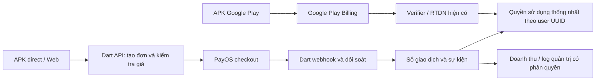

# Kế hoạch PayOS, đăng nhập SĐT và phân quyền tùy chỉnh

Ngày: 03/11/2026 — Cập nhật 04/11/2026: đã triển khai source PayOS, đăng nhập SĐT, PIN web và quyền tùy chỉnh; API/web/worker đã deploy, Supabase có 53 migration, PayOS/PIN đã bật và giữ Play Billing. Tiền thật và [phân quyền/MFA trên production](RBAC_PRODUCTION_ACCEPTANCE_20261104.md) đã nghiệm thu. SMS/OTP để lại theo yêu cầu. Xem [nghiệm thu production và giới hạn còn lại](PAYOS_PRODUCTION_DEPLOYMENT_20261104.md) và [phạm vi implementation](PAYOS_AUTH_RBAC_IMPLEMENTATION_20261104.md); các mục đề xuất còn lại dưới đây không mặc nhiên được coi là đã hoàn thành.

Chuyển tiếp trước khi có SMS: source web/mobile giữ **email + mật khẩu và Google**, đồng thời cho phép SĐT + mật khẩu với tài khoản đã có. Không bắt tài khoản email cũ đổi SĐT để dùng PayOS; mục tiêu phone-only dưới đây chỉ rollout sau khi có xác minh/chuyển tài khoản.

Yêu cầu đã làm rõ: **đăng nhập chính bằng SĐT + mật khẩu trên cả web/mobile; xác thực thông tin bằng Zalo OTP 6 số; đăng nhập nhanh bằng sinh trắc học trên mobile hoặc PIN trên web; admin gán từng quyền tùy chọn cho bất kỳ user trong hệ thống**. Giảng viên chỉ xem Finance là một ví dụ cấu hình. Thời hạn gói, thông số PIN nhanh và cách rollout bên dưới là đề xuất kỹ thuật. Lượt này hoàn thiện kế hoạch theo phạm vi đã xác nhận.

## 1. Phạm vi yêu cầu và phương án đề xuất

| Hạng mục | Hành vi đích |
|---|---|
| APK Google Play | Mua gói bằng Google Play Billing; giữ verify, acknowledge, restore và RTDN hiện có. |
| APK phát hành trực tiếp | Mua gói bằng PayOS, gắn với tài khoản Picket. |
| Web | Dùng PayOS cho thanh toán gói; thời điểm bật checkout web trong lần phát hành đầu cần chốt khi triển khai. |
| Đăng nhập chính | SĐT + mật khẩu trên cả web/mobile; tài khoản mới không yêu cầu email. |
| Xác thực thông tin | Zalo OTP đúng 6 chữ số cho đăng ký/xác minh SĐT, phục hồi và thay đổi thông tin nhạy cảm theo chính sách. |
| Đăng nhập nhanh web | PIN riêng do user bật cho trình duyệt đã đăng ký sau khi đăng nhập chính; vẫn có lựa chọn dùng mật khẩu. |
| Đăng nhập nhanh mobile | Sinh trắc học sau khi đăng nhập chính và đăng ký thiết bị; vẫn có lựa chọn dùng mật khẩu. |
| Quản trị | Thêm menu Doanh thu, Giao dịch thanh toán và timeline từng giao dịch. |
| Phân quyền | Admin chọn user, cấp/thu hồi quyền theo chức năng và thao tác; có thể tạo nhóm quyền tùy chỉnh để tái sử dụng. |
| Ví dụ giảng viên | Admin chỉ chọn quyền xem doanh thu và log Finance cho user đó; không có role giảng viên mặc định trong code. |

Doanh thu trong kế hoạch này là tiền bán gói của Picket. Các khoản thu/chi cá nhân trong `/v1/transactions` vẫn là nghiệp vụ khác, không nhập chung vào doanh thu nền tảng.

## 2. Hiện trạng cần tận dụng và khoảng trống

- Dart Frog tại `apps/api` là backend nghiệp vụ duy nhất. Expo/Next.js dùng Supabase Auth cho phiên; dữ liệu nghiệp vụ đi qua API Dart theo `.agents/rules/architecture.md`.
- Đã có `/v1/billing/google-play/verify`, `/v1/billing/availability`, `/v1/entitlements`, `play_purchases`, `plan_grants`, `current_plan()` và `current_entitlements()`.
- Verifier/RTDN Google Play hiện còn thành phần legacy Supabase Functions. Giữ hoạt động trong lần mở rộng này; không ghép thêm việc di chuyển toàn bộ verifier vào cùng đợt triển khai PayOS.
- Mobile đã có `DeviceLockProvider`, `expo-local-authentication` và session storage bằng SecureStore. Đây là nền tảng mở khóa cục bộ; chưa phải đăng nhập cloud bằng vân tay.
- Admin đã có menu billing/audit/staff và các role cố định owner/operations/support/analyst/content. Cần chuyển ánh xạ role → quyền và kiểm tra tên role sang danh mục/nhóm quyền lưu trong DB, gán được cho từng user. Tận dụng portal hiện có.
- Điểm chặn phone-only: `picket_private.account_access()` hiện yêu cầu `email_confirmed_at`. Các thống kê verified user, tìm kiếm/xuất user, reset password và `admin_contract.dart` cũng đang phụ thuộc email. Phải sửa đồng bộ trước khi mở đăng nhập SĐT.
- `PICKET_PLAY_BUILD` hiện chủ yếu phục vụ update channel. Cần mở rộng cấu hình phân phối để chọn đúng checkout; không coi cờ hiện tại là hệ thống PayOS đã có.
- `mobileAccessAllowed()` hiện yêu cầu `staff === false`; `account_access()` đặt `mobileAllowed` theo việc có thuộc staff hay không. Cần tách quyền vào portal và quyền dùng ứng dụng cá nhân: cấp một quyền quản trị cho user không tự đổi user thành tài khoản chỉ dùng web hoặc làm mất quyền mobile/dữ liệu riêng.
- Web hiện dùng `createBrowserClient` và cookie SSR trong `web/src/core/supabase/`. PIN nhanh cần PoC về phiên phía server và khóa truy cập thật, không chỉ thêm màn nhập PIN trước UI đang có token sử dụng được.

Các điểm nối đã đối chiếu với mã nguồn ngày 03/11/2026:

| Phần | File hiện có cần mở rộng khi triển khai |
|---|---|
| Auth mobile và phiên | `apps/mobile/src/features/auth/auth-context.tsx`, `apps/mobile/src/core/storage/secure-auth-storage.ts` |
| Khóa thiết bị | `apps/mobile/src/features/security/device-lock.tsx` |
| Auth web | `web/src/app/login/login-form.tsx`, `web/src/features/auth/` |
| Menu, route và mutation admin | `web/src/features/admin/admin-permissions.ts`, `web/src/features/admin/components/`, `apps/api/routes/v1/admin/` |
| Kiểm tra account/role | `supabase/migrations/20261027182538_admin_platform.sql` là nguồn hiện trạng; thay đổi bằng migration mới, không sửa migration cũ |
| Quyền mobile và phiên web | `apps/mobile/src/features/auth/mobile-access-policy.ts`, `web/src/core/supabase/client.ts`, `web/src/core/supabase/server.ts` và luồng proxy/API web |
| Contract và recovery admin | `apps/api/lib/src/admin_contract.dart`, `apps/api/lib/src/admin_service.dart` |
| Billing và entitlement | `apps/mobile/src/features/billing/`, `apps/api/lib/src/billing_contract.dart`, `apps/api/routes/v1/entitlements.dart` và resolver DB |
| Contract dùng chung | `packages/domain-ts/src/billing.ts`, `packages/api-client/src/index.ts`, `apps/api/public/openapi.yaml` |

## 3. Thiết kế hai kênh thanh toán

- Artifact Play chỉ hiển thị luồng Play Billing. Kiểm tra cả đường dẫn từ đăng ký, trợ giúp và quản lý tài khoản để không dẫn sang checkout PayOS trong bản Play. Đối chiếu chính sách tại thời điểm phát hành; không áp dụng ngoại lệ theo thị trường nếu chưa đăng ký chương trình phù hợp. [Chính sách Payments](https://support.google.com/googleplay/android-developer/answer/9858738?hl=en).
- Chọn provider trong cấu hình build và adapter UI; feature flag chỉ bật/tắt provider vốn được phép trong artifact đó. Không để remote flag biến bản Play thành bản có nút PayOS.
- Backend không tin `channel`, giá, user ID hoặc trạng thái thanh toán do client tự khai. Channel phục vụ trải nghiệm/analytics; tài khoản lấy từ phiên, giá và quyền lấy từ server.
- Quyền sử dụng thống nhất theo UUID Picket; lịch sử và vòng đời từng provider vẫn được giữ riêng. Không tạo lại tài khoản khi chuyển APK hoặc đổi cách đăng nhập.
- PayOS MVP bán quyền trả trước theo tháng/năm, người dùng chủ động thanh toán lần gia hạn tiếp theo. Payment-link contract đã kiểm tra không cung cấp hợp đồng tự động trích tiền định kỳ tương đương Play subscription; không quảng bá tự gia hạn khi chưa có sản phẩm/hợp đồng xác nhận.
- Đề xuất MVP chặn mua trùng giữa hai provider khi đang có gói trả phí còn hiệu lực. Hiển thị nguồn gói và cách quản lý tương ứng. Gia hạn PayOS cùng tier có thể nối kỳ; nâng/hạ tier, chuyển provider giữa kỳ và prorating phải có quy tắc giá được duyệt trước.
- Chốt rõ một tháng/một năm là kỳ lịch hay số ngày cố định; đề xuất kỳ lịch và kiểm thử ngày cuối tháng/năm nhuận. Không cộng thêm thời hạn mỗi lần nhận lại webhook.

## 4. Tích hợp API PayOS

Đề xuất adapter REST trong Dart, tái sử dụng `http`, dùng thư viện HMAC chuẩn và vector kiểm thử từ implementation chính thức. SDK overview hiện không liệt kê Dart server SDK; không thêm Node sidecar chỉ để gọi PayOS. [SDK PayOS](https://payos.vn/docs/sdks/intro/).

Các API cần dùng phía server:

| API provider | Mục đích |
|---|---|
| `POST /v2/payment-requests` | Tạo link/QR thanh toán. |
| `GET /v2/payment-requests/{id}` | Đối soát đơn và các giao dịch nhận tiền. |
| `POST /v2/payment-requests/{id}/cancel` | Hủy link chưa hoàn tất. |
| `POST /confirm-webhook` | Đăng ký/kiểm tra endpoint webhook. |

API dùng `x-client-id`, `x-api-key` và chữ ký HMAC-SHA256 bằng checksum key. `buyerEmail` là tùy chọn nên không cần bắt khách hàng cung cấp email. Dùng số tiền nguyên VND, orderCode duy nhất và kiểm tra hạn link/mô tả theo kênh ngân hàng đã đăng ký. [API chính thức](https://payos.vn/docs/api/).

Luồng checkout dự kiến:

1. User đã đăng nhập chọn gói. API kiểm tra quyền, gói đang có và bảng giá server; lưu snapshot giá/kỳ hạn cùng UUID chủ đơn.
2. Tạo đơn nội bộ và orderCode bền vững trước khi gọi provider. API của Picket nhận `Idempotency-Key`; không giả định PayOS create-link cũng hỗ trợ header này.
3. Gọi provider, lưu paymentLinkId và trả checkout URL/QR hợp lệ cho đúng chủ đơn. Nếu timeout không rõ kết quả, query lại orderCode cũ thay vì tạo đơn mới.
4. Mobile mở trang checkout trong trình duyệt hệ thống; web chuyển tới checkout. Có trang HTTPS trung gian để quay về ứng dụng, đồng thời hỗ trợ người thanh toán trên cùng điện thoại bằng luồng mở app ngân hàng/sao chép nội dung phù hợp.
5. Webhook xác thực chữ ký, đối chiếu signed data với merchant/kênh, đơn, tiền và currency; ghi inbox bền vững rồi xử lý giao dịch và cấp quyền trong một transaction idempotent. Chỉ ACK thành công sau khi đã ghi nhận bền vững.
6. Return URL chỉ hiển thị tiến trình và đọc trạng thái từ API. Không dùng `success=true`, ảnh chụp chuyển khoản hay trạng thái client để cấp gói. [Webhook](https://payos.vn/docs/du-lieu-tra-ve/webhook/), [return URL](https://payos.vn/docs/du-lieu-tra-ve/return-url/).
7. Worker retry và đối soát xử lý webhook chậm/mất, create timeout, thanh toán thiếu/thừa, quá hạn hoặc không khớp đơn. Khoản nhận tiền bất thường vào hàng đợi kiểm tra; không tự bỏ qua tiền đã nhận hoặc cấp gói sai giá.

Các invariant triển khai: unique transaction reference trong phạm vi merchant/provider; unique entitlement grant cho đơn đủ điều kiện; khóa/kiểm soát cạnh tranh khi cập nhật; không hạ một đơn đã trả tiền về pending vì sự kiện cũ. Giữ trạng thái gốc provider riêng với trạng thái ứng dụng. Webhook mẫu/đơn không biết không được tạo entitlement. Chữ ký phải theo canonicalization chính thức, kiểm tra cả signed data thay vì chỉ nhìn outer `success`. [Hướng dẫn signature](https://payos.vn/docs/tich-hop-webhook/kiem-tra-du-lieu-voi-signature/), [SDK webhook](https://github.com/payOSHQ/payos-lib-node/blob/main/src/resources/webhooks/webhook.ts).

Thông tin cần lưu để đáp ứng yêu cầu đọc API và tra cứu giao dịch:

| Nhóm | Dữ liệu dự kiến |
|---|---|
| Đối chiếu đơn | ID nội bộ, UUID chủ đơn, merchant/channel nội bộ, `orderCode`, `paymentLinkId`, SKU và snapshot giá/kỳ hạn |
| Kết quả link | `checkoutUrl`, QR, trạng thái gốc, thời điểm tạo/hết hạn/hủy; số tiền yêu cầu/đã trả/còn thiếu khi provider trả về |
| Khoản tiền nhận | `reference`, `amount`, `currency`, `transactionDateTime`, thời điểm server nhận/xác minh và nguồn webhook hay đối soát |
| Thông tin ngân hàng | Tài khoản nhận và các trường đối ứng nếu provider cung cấp; hạn chế truy cập, chỉ giữ phần cần đối soát; trường thiếu giữ null |
| Vận hành | Event ID, hash payload, kết quả kiểm chữ ký, trạng thái xử lý/retry, correlation ID và liên kết entitlement/refund |

Tên trường provider đối chiếu theo [API PayOS](https://payos.vn/docs/api/) và [webhook PayOS](https://payos.vn/docs/du-lieu-tra-ve/webhook/). Dữ liệu gửi tới UI là DTO đã lọc theo quyền. Bản payload phục vụ đối soát, nếu cần giữ, nằm trong vùng nội bộ có thời hạn lưu; không đưa nguyên payload vào log hoặc timeline người dùng thông thường được xem.

Một đơn có thể có nhiều khoản nhận tiền. Ghi mỗi reference hợp lệ đúng một lần; phân biệt số tiền của từng giao dịch với tổng đã trả cho đơn. Đối soát tổng trước khi quyết định đủ tiền/cấp gói. Thiếu tiền, thừa tiền, tiền đến sau hủy/hết hạn hoặc dữ liệu không khớp được đánh dấu cần kiểm tra, không tự mất khỏi danh sách vì đơn không còn pending. Trạng thái tiền và trạng thái cấp quyền được lưu riêng để phát hiện trường hợp đã nhận tiền nhưng cấp quyền lỗi.

Hủy link không phải hoàn tiền. MVP có quy trình ghi nhận hoàn tiền đã được owner xử lý, có lý do/chứng cứ và điều chỉnh ledger/quyền phù hợp. Tự động chuyển tiền hoàn bằng sản phẩm chi hộ là hạng mục sau, cần onboarding và quyền riêng; không đưa lệnh payout tự động vào checkout MVP. [Dịch vụ chi hộ](https://payos.vn/dang-ky-dich-vu-chi-ho/).

## 5. Dữ liệu và entitlement

Tên dưới đây là đề xuất logic; khi implement cần đối chiếu schema, tạo migration mới và giữ tương thích dữ liệu cũ.

| Nhóm dữ liệu | Nội dung chính |
|---|---|
| Danh mục gói/giá | Tier, kỳ hạn, giá/currency, provider SKU, phiên bản giá, bật/tắt. |
| Billing orders | UUID đơn, UUID user, provider/channel, snapshot giá, orderCode/paymentLinkId, trạng thái, hạn link, khóa idempotency. |
| Payment transactions | Giao dịch tiền thực tế, ref provider, số tiền/currency, paidAt, refund/adjustment liên quan, trạng thái đối soát, test flag do server kiểm soát. |
| Billing events/inbox | Sự kiện nhận/xử lý, dedup key, lần retry, kết quả, correlation ID; timeline không sửa đè. |
| Billing entitlement grants | Nguồn đơn, tier, effectiveAt/expiresAt, revokeAt; liên kết duy nhất để chống cấp trùng. |
| Danh mục quyền | Mã quyền, chức năng/thao tác, mô tả, phạm vi dữ liệu hỗ trợ, điều kiện MFA và các quyền phụ thuộc. |
| Nhóm quyền và thành viên | Nhóm do admin đặt tên, tập quyền trong nhóm, user được gán và hiệu lực/hết hạn; không cố định theo nghề nghiệp. |
| Quyền riêng từng user | User, permission, allow/deny, scope, hiệu lực/hết hạn, người cấp/thu hồi, lý do và revision chống ghi đè thay đổi đồng thời. |
| Audit phân quyền | Snapshot quyền trước/sau, actor/target, thời điểm và correlation ID; người được cấp quyền không tự sửa audit. |
| Đăng nhập nhanh | User/thiết bị hoặc trình duyệt, session liên kết, hạn/thu hồi, metadata xác thực và verifier PIN được bảo vệ nếu dùng; không lưu mật khẩu/PIN thô. |
| OTP delivery metadata | Kênh Zalo, provider message ID, purpose, delivery status, lần gửi và thời điểm; không lưu OTP thô. |

- Tiền lưu chính xác bằng integer minor units kèm currency; PayOS VND không có phần lẻ. Không dùng float, không cộng trực tiếp VND với USD. Thời gian lưu UTC có timezone; lọc/nhóm lịch theo `Asia/Ho_Chi_Minh`. Timestamp provider không có offset cần xác nhận timezone khi tích hợp.
- Cập nhật resolver entitlement để đọc Play hợp lệ, PayOS grant và manual `plan_grants`. Gói cấp thủ công/test không trở thành doanh thu. Tránh sửa mỗi UI mà bỏ sót `current_plan()`, quota OCR, bộ lọc admin hoặc thống kê effective tier.
- Bảo toàn invariant Play hiện có về xác minh mới nhất, active/expiry, thay thế purchase token và thu hồi. Không làm gói PayOS mất quyền chỉ vì không có `play_purchases`.
- Bật RLS/quyền gọi phù hợp; client không ghi trực tiếp payment/grant/binding quyền. Privileged write chỉ qua backend đã xác thực provider hoặc người có capability tương ứng; không cấp service key cho mobile/web. Bảng quyền có khóa ngoại và index phục vụ tra cứu user/permission/hiệu lực; các thay đổi quyền và audit được ghi trong cùng transaction.
- Ledger cần chính sách retention và pseudonymization khi xóa tài khoản; tránh cascade làm mất doanh thu/đối soát. Cập nhật luồng purge hiện có và chỉ giữ dữ liệu cần thiết theo chính sách được duyệt.

## 6. Đăng nhập SĐT + mật khẩu và đăng nhập nhanh

### Đăng nhập chính trên web và mobile

`Đăng ký: SĐT + mật khẩu + xác nhận mật khẩu → Zalo OTP 6 số → tài khoản đã xác minh`.

`Đăng nhập thông thường: SĐT + mật khẩu → phiên hợp lệ → xác thực bổ sung khi chính sách yêu cầu`.

- Chuẩn hóa SĐT Việt Nam sang E.164 (`+84`), chống trùng sau chuẩn hóa. Form mới không dùng email làm thông tin đăng nhập; không tạo email giả từ SĐT.
- Mật khẩu do Supabase Auth quản lý. Tách biệt mật khẩu, OTP xác thực một lần và PIN đăng nhập nhanh; không đặt PIN làm password của Auth. Có hiển thị/ẩn mật khẩu và hỗ trợ trình quản lý mật khẩu.
- Supabase hỗ trợ `signInWithPassword({ phone, password })`; tích hợp theo contract hiện hành và kiểm tra tài khoản active/phone verified trước truy cập nghiệp vụ. [Đăng nhập phone/password](https://supabase.com/docs/reference/javascript/auth-signinwithpassword).
- OTP dùng khi đăng ký, xác minh/đổi SĐT, quên mật khẩu và các thao tác cần xác thực thông tin. Luồng đăng nhập mặc định vẫn là SĐT + mật khẩu. Rate limit, CAPTCHA khi cần và chống dò phải bao phủ cả Auth trực tiếp.
- Backend xác minh bước bổ sung theo user/session, mục đích, thời hạn và thao tác đích; không tin cờ `otpVerified` từ client. PoC phải kiểm tra đường gọi Auth trực tiếp và session sinh từ OTP recovery để không bỏ qua các điều kiện này.

### Đăng nhập nhanh mobile bằng sinh trắc học

- Sau một lần đăng nhập chính thành công, user tự chọn bật vân tay/khuôn mặt cho thiết bị hỗ trợ. Tận dụng `DeviceLockProvider`, `expo-local-authentication` và SecureStore.
- OS xác thực để mở quyền dùng phiên lưu an toàn trên thiết bị. Không gửi dữ liệu vân tay lên server hoặc lưu mật khẩu để tự điền sau sinh trắc học.
- Access token có thể được refresh bằng phiên còn hiệu lực. Khi phiên/thiết bị bị thu hồi, hết thời hạn cho phép hoặc đăng nhập trên máy mới, yêu cầu lại SĐT + mật khẩu; OTP chỉ xuất hiện khi cần xác thực bổ sung.
- Rà bảo vệ việc đọc token/dữ liệu cục bộ khi khóa, background/resume, thay đổi bộ vân tay và đổi user. Thiết bị không hỗ trợ hoặc user hủy xác thực có lựa chọn dùng mật khẩu. Kiểm thử migration storage để bảo toàn dữ liệu hiện có.

### Đăng nhập nhanh web bằng PIN

- User đăng nhập bằng SĐT + mật khẩu, xác thực bổ sung theo chính sách rồi chọn **Bật đăng nhập nhanh trên trình duyệt này**, đặt/xác nhận PIN riêng. Thiết bị/trình duyệt mới phải đăng nhập chính trước khi đăng ký PIN.
- PIN gắn với user và trình duyệt đã đăng ký, có hạn và có thể thu hồi. User có thể chọn dùng mật khẩu bất kỳ lúc nào. Độ dài PIN là cấu hình cần chốt sau PoC, độc lập với yêu cầu OTP cố định 6 số.
- Phải kiểm tra PIN và trạng thái đăng ký trên server, giới hạn lần nhập và khóa đăng nhập nhanh khi vượt ngưỡng; yêu cầu mật khẩu để khôi phục. Không lưu PIN thô, hash PIN dễ dò hoặc mật khẩu trong profile/localStorage; verifier dùng cơ chế băm mật khẩu phù hợp và bảo vệ khóa phía server.
- Phương án đem PoC: cookie định danh trình duyệt ngẫu nhiên `HttpOnly`/`Secure`/`SameSite`, PIN verifier phía server và phiên Supabase liên kết được giữ mã hóa phía server; chỉ tiếp tục/refresh phiên sau khi kiểm tra PIN, binding và trạng thái thu hồi. Bảo vệ CSRF/origin, xoay cookie/refresh token và xử lý nhiều tab đồng thời.
- Phương án này cần lớp proxy phiên cho web: Next.js chỉ vận chuyển cookie/request cùng origin; logic PIN, điều kiện truy cập và quản lý binding ở Dart API. Các đường gọi dữ liệu/refresh phải tuân theo trạng thái khóa; không để cookie hoặc token Supabase đang dùng được ở browser vượt màn PIN. Phải rà toàn bộ browser client/SSR/proxy và API call hiện có trước khi chốt implementation.
- Supabase vẫn phát hành token/phiên; service PIN không tự ký JWT và không dùng quyền admin để giả đăng nhập user. Phiên đã bị thu hồi không được khôi phục chỉ bằng PIN. Đây là thiết kế cần PoC, chưa phải capability PIN có sẵn trong Supabase SDK. [Vòng đời phiên và refresh token](https://supabase.com/docs/guides/auth/sessions).
- Đổi/quên PIN: đăng nhập chính rồi đặt lại PIN cho trình duyệt. Quên mật khẩu: dùng luồng Zalo OTP recovery rồi đặt mật khẩu mới. Đăng xuất, thu hồi thiết bị hoặc đổi thông tin bảo mật phải xử lý binding/phiên theo chính sách rõ ràng.

Các luồng cần có trên giao diện:

| Luồng | Các bước và kết quả |
|---|---|
| Đăng ký web/mobile | SĐT + mật khẩu + xác nhận → Zalo OTP 6 số → tài khoản đã xác minh → tùy chọn bật đăng nhập nhanh |
| Đăng nhập web/mobile | SĐT + mật khẩu → xác thực bổ sung khi cần → phiên hợp lệ |
| Web đã bật PIN | Chọn tài khoản đã nhớ trên trình duyệt → nhập PIN → server kiểm tra → tiếp tục phiên được phép |
| Mobile đã bật sinh trắc học | OS xác thực → mở phiên hợp lệ trên thiết bị; user có lựa chọn dùng mật khẩu |
| Quên mật khẩu | SĐT → Zalo OTP 6 số theo mục đích recovery → đặt/xác nhận mật khẩu mới → thu hồi phiên/binding cũ theo chính sách |
| Quên PIN/trình duyệt mới | SĐT + mật khẩu → xác thực bổ sung nếu cần → đăng ký lại PIN |
| Liên kết tài khoản cũ | Xác thực tài khoản hiện có → thêm SĐT → Zalo OTP 6 số → đặt/kiểm tra mật khẩu → giữ nguyên UUID/dữ liệu |

Thông báo lỗi đăng nhập/recovery không tiết lộ SĐT có tài khoản hay không. Form OTP hỗ trợ bàn phím số, dán mã, countdown gửi lại và lỗi mạng/provider rõ ràng. Màn khóa nhanh không được hiển thị trước dữ liệu nhạy cảm khi mở lại app/web.

### Tài khoản hiện có và xác thực bổ sung

- Tài khoản email/Google hiện có liên kết SĐT vào cùng UUID sau khi xác minh phiên và Zalo OTP; thiết lập mật khẩu nếu chưa có. Không ghép tài khoản chỉ vì trùng email/SĐT/buyerPhone.
- Chỉ duy trì đường email/Google cũ trong cửa sổ migration có hạn để tránh khóa user; đích sau chuyển đổi là đăng nhập SĐT + mật khẩu. Kiểm tra entitlement, tài chính cloud/offline và owner cache sau chuyển đổi.
- Sửa `account_access`, contract admin, tìm kiếm, thống kê verified user và recovery cho phone-only. Giữ kiểm tra tài khoản active, session revoke và owner isolation; khả năng dùng mobile/portal dựa trên policy riêng như mục 8.
- Đổi SĐT cần xác thực phiên/mật khẩu và OTP tới SĐT mới, kèm bước bảo vệ SĐT cũ/recovery phù hợp. Quên mật khẩu/đổi SĐT phải xét rủi ro SIM mất hoặc tái cấp số, không tự ghi đè tài khoản.
- Quyền nhạy cảm vẫn yêu cầu MFA/step-up phía server. Zalo OTP xác minh thông tin, PIN và sinh trắc học cục bộ không tự biến phiên thành Supabase `aal2`; PoC xác định cách đáp ứng MFA tương ứng.

## 7. Xác thực thông tin bằng Zalo OTP 6 số

- Kênh triển khai là Zalo OTP ngay từ giai đoạn phone auth. OTP là chuỗi đúng 6 chữ số, giữ cả số 0 ở đầu; cấu hình độ dài ở nguồn phát hành và kiểm tra contract gửi/nhận. SMS là khả năng mở rộng sau nếu có quyết định mới, không phải phụ thuộc cho bản này.
- Supabase tiếp tục phát hành/xác minh OTP và phiên cho các flow Auth hỗ trợ. Đề xuất Send SMS Hook chuyển mã tới adapter Zalo ở Dart; tên hook là của Supabase, không có nghĩa người dùng nhận SMS. Xác thực chữ ký/timestamp, chống replay hook và không ghi OTP vào log. [Send SMS Hook](https://supabase.com/docs/guides/auth/auth-hooks/send-sms-hook).
- Zalo cần AppID/OA liên kết, ủy quyền và mẫu xác thực được duyệt theo sản phẩm ZBS/ZNS của tài khoản thực tế. Adapter truyền OTP 6 số vào mẫu; không dùng Zalo cá nhân hoặc Zalo Social Login để thay việc gửi OTP. [Mẫu xác thực chính thức](https://zalo.solutions/blog/cach-su-dung-va-ung-dung-cua-mau-xac-thuc/g8yv8lcpvmj0c0wonqbpibgj).
- PoC chứng minh route gửi/xác minh cho từng purpose: đăng ký, đổi SĐT, recovery và step-up. Dùng đúng flow Auth được hỗ trợ; không giả định SDK có `channel: 'zalo'` hoặc chỉ đổi tên channel là đủ. Xác thực thao tác nghiệp vụ cần challenge/receipt có mục đích và ràng buộc server, không cấp quyền bằng cờ UI.
- Giới hạn theo SĐT/IP/thiết bị/tài khoản, quota chi tiêu và cảnh báo gửi bất thường. Mốc đề xuất để PoC: hiệu lực 3 phút, tối đa 5 lần nhập, gửi lại sau 60 giây; kiểm chứng cấu hình thật trước rollout. Gửi lại phải có chính sách mã cũ, dedup và chống replay; user không tự sửa purpose/SĐT sau khi challenge được tạo.
- Provider lỗi, user không nhận được Zalo hoặc chưa có Zalo: hiển thị trạng thái và hỗ trợ retry/recovery đã xác minh; không tự bỏ xác thực hoặc chuyển SMS chưa được cấu hình/duyệt. Theo dõi send/delivery/verify/chi phí riêng, không suy từ API nhận yêu cầu thành OTP đã đến.

## 8. Menu quản trị và phân quyền tùy chỉnh cho từng user

Đề xuất nhóm menu **Tài chính nền tảng**:

1. **Doanh thu**: hôm nay, tháng này, năm nay, tùy chọn từ ngày/giờ đến ngày/giờ; lọc provider, kênh, gói, currency và live/test.
2. **Giao dịch thanh toán**: toàn bộ đơn/giao dịch PayOS và Google Play trong phạm vi dữ liệu đã nhập; tìm mã đơn, lọc trạng thái, thời gian, provider. Hiển thị số tiền, trạng thái tiền/quyền, thời điểm và khách hàng theo mức quyền.
3. **Chi tiết giao dịch**: timeline tạo đơn, mở link, provider xác nhận, webhook/đối soát, cấp quyền, gia hạn, hoàn/điều chỉnh; chỉ trả dữ liệu theo capability và scope đang hiệu lực.

Quy ước bộ lọc và trải nghiệm báo cáo:

- “Ngày/tháng/năm” là kỳ lịch theo `Asia/Ho_Chi_Minh`; có chọn kỳ cụ thể và từ ngày/giờ đến ngày/giờ. API chuẩn hóa sang khoảng UTC nửa mở `[from, to)`. Ví dụ ngày 03/11/2026 tương ứng `2026-11-02T17:00:00Z` đến trước `2026-11-03T17:00:00Z`.
- Tiền thu theo thời điểm khoản tiền được xác nhận; hoàn tiền theo thời điểm hoàn được xác nhận. Biểu đồ, tổng số, bảng chi tiết và export được cấp quyền phải dùng cùng bộ lọc và quy tắc thời gian. Lọc trạng thái đơn theo thời điểm tạo là lựa chọn riêng, có nhãn rõ.
- Danh sách có phân trang; chọn một hàng mở timeline. Trạng thái đơn, khoản tiền và quyền sử dụng được trình bày riêng. Sự kiện “mở checkout” chỉ là telemetry, không chứng minh đã trả tiền.
- Có trạng thái đang tải, lỗi có thử lại, không có giao dịch và thiếu nguồn/chưa đối soát. Đơn đang chờ không nằm trong doanh thu đã nhận nhưng vẫn xem được trong menu Giao dịch. Tối ưu bảng cho phone/tablet/laptop và giữ ngôn ngữ thiết kế hiện có.

Các chỉ số: tiền thu đã xác nhận, hoàn tiền đã xác nhận, thu trừ hoàn, số đơn đã thanh toán và trạng thái đối soát. Pending, free/manual grants, test và license-test không được cộng vào tiền thu thực. Phí/thuế chỉ tính khi có nguồn xác thực; thu trừ hoàn không được gọi là lợi nhuận. Net có thể âm ở kỳ có hoàn tiền của kỳ trước.

Google Play cần thêm nguồn tiền thực tế, không lấy số user active nhân giá gói. Nối reports/Orders API phù hợp vào nguồn admin hiện có; tách sales ước tính và earnings đã đối soát, hiển thị độ trễ/mốc cập nhật và coverage. Thiếu dữ liệu phải hiển thị chưa có nguồn/chưa đối soát, không tự báo 0. [Financial reports](https://support.google.com/googleplay/android-developer/answer/2482017?hl=en-en), [report definitions](https://support.google.com/googleplay/android-developer/answer/6135870?hl=en-EN).

### Danh mục và cách gán quyền

Admin mở **Người dùng → chọn user → Quyền truy cập**, tự chọn các quyền phù hợp. Có thể gán trực tiếp cho user, tạo nhóm quyền có tên tùy ý và kết hợp nhóm với ngoại lệ riêng cho user. Tất cả cấu hình này lưu trong DB và thay đổi qua portal, không cần sửa code hoặc phát hành app để đổi người được cấp/tập quyền trong nhóm.

Mã quyền biểu diễn hành động mà backend thực sự hỗ trợ. Khi thêm tính năng mới, code khai báo capability tương ứng; admin chọn tổ hợp các capability đã có, không nhập SQL hoặc tạo tên quyền tùy ý rồi tự mở được chức năng.

| Nhóm chức năng | Ví dụ quyền trong danh mục |
|---|---|
| Truy cập portal | `admin.portal.access`; quyền này chỉ mở portal, không tự cấp dữ liệu các module |
| Finance | `finance.revenue.read`, `finance.payments.read`, `finance.payment-events.read`, `finance.payments.export` |
| Dữ liệu thanh toán nhạy cảm | `finance.payments.pii.read`; tách khỏi quyền xem báo cáo thông thường |
| Thao tác billing | `billing.grants.create`, `billing.refunds.record`, `billing.catalog.update`; mỗi hành động được triển khai có quyền riêng và step-up |
| Người dùng | `users.read`, `users.invite`, `users.update`, `users.suspend`, `users.sessions.revoke`; đọc PII/xuất dữ liệu là quyền riêng |
| Các module admin đang có | Capability xem/tạo/sửa/xóa/xuất phù hợp cho OCR, content, tickets, partners, releases, settings, audit và các module còn lại |
| Quản lý quyền | `iam.permissions.read`, `iam.assignments.manage`, `iam.groups.manage`; phạm vi được ủy quyền được kiểm tra riêng |

Các thao tác không tồn tại trong một module không hiện checkbox giả. Màn hình có tìm kiếm user bằng SĐT/ID, tìm kiếm quyền theo module, chọn thao tác, scope, thời gian bắt đầu/hết hạn, lý do; hiển thị **quyền hiệu lực** và nguồn từ nhóm hay gán riêng trước khi lưu. Export, PII, phân quyền, cấp gói và hoàn tiền không được suy ra từ quyền xem/sửa chung.

### Quy tắc đánh giá quyền trên server

1. Kiểm tra user/session còn hợp lệ, điều kiện xác minh và quyền vào portal. Trong ngữ cảnh quản trị, mặc định từ chối khi chưa có quyền cho hành động.
2. Tập quyền hiệu lực = quyền allow từ các nhóm đang hiệu lực cộng allow gán riêng, trừ deny gán riêng trong phạm vi trùng khớp. Deny ưu tiên; binding hết hạn/thu hồi không tham gia. Scope được backend chuẩn hóa và kiểm tra bao phủ tài nguyên; bản đầu hỗ trợ các scope đã định nghĩa rõ, không tự tạo bộ lọc SQL từ JSON client.
3. Mỗi API/RPC kiểm tra capability + action + scope + step-up nếu cần. Frontend lấy tập quyền hiệu lực từ server để render menu/nút và chọn trang đầu tiên được phép; không dùng tên nhóm hoặc nghề nghiệp để quyết định quyền.
4. Hết hạn/thu hồi có hiệu lực từ request server tiếp theo, kể cả giữ JWT/tab cũ. Dùng revision/invalidation cho cache quyền và kiểm tra binding hiện hành; không dùng JWT cũ hoặc `user_metadata` làm nguồn quyền cuối cùng.
5. Chỉ admin có quyền quản lý assignment/nhóm trong phạm vi được ủy quyền mới thay đổi được quyền. Không tự nâng quyền hoặc cấp quyền/scope vượt tập được ủy quyền. Thay đổi nhóm phải kiểm tra tác động lên tất cả thành viên và không trở thành đường vòng nâng quyền.
6. Cấp/thu hồi quyền nhạy cảm cần MFA, revision chống mất cập nhật và audit trước/sau trong transaction. Bảo vệ tối thiểu một tài khoản quản trị quyền đầy đủ còn hiệu lực, kể cả khi xóa nhóm hoặc đặt ngày hết hạn; có quy trình recovery riêng.
7. RLS và các RPC nội bộ kiểm tra quyền tương đương API. Tránh cấp SELECT bảng PII hoặc quyền ghi binding trực tiếp chỉ vì có quyền vào portal. Người có quyền đọc danh mục chỉ được xem phần được phép; quyền tự đọc của mình không mở danh sách quyền user khác.

Mask/pseudonymize tại query/DTO server theo quyền PII và scope; không trả đủ dữ liệu rồi che bằng CSS. Quyền export chỉ xuất cùng tập cột/hàng được phép đọc. Secret, OTP/PIN/mật khẩu và token không nằm trong danh mục quyền hiển thị cho user quản trị.

### User hệ thống, quyền ứng dụng và ví dụ sử dụng

- Gán quyền vào **chính UUID user hiện có**. Không bắt tạo tài khoản riêng vì được cấp một quyền quản trị. Quyền portal, quyền app cá nhân và entitlement gói là các chiều độc lập; một user được cấp Finance vẫn dùng app cá nhân theo policy của mình.
- Cập nhật `account_access`, native access boundary và các kiểm tra staff hiện có để hỗ trợ mô hình này. Các tài khoản nội bộ chỉ được dùng portal có thể áp dụng policy kênh riêng, không suy ra từ việc user có bất kỳ quyền admin nào.
- Quyền Finance quản trị là dữ liệu doanh thu/thanh toán của nền tảng. Ledger, hóa đơn, ví và thu/chi cá nhân tiếp tục owner-scoped; cấp quyền Finance không tự mở dữ liệu cá nhân của user khác.
- Ví dụ user A là giảng viên: admin chọn `admin.portal.access` và ba quyền đọc Finance, có thể đặt ngày hết hạn. User A chỉ thấy menu Doanh thu/Giao dịch, không export/PII/mutation. Nếu admin thêm hoặc thu hồi một quyền, hành vi thay đổi theo cấu hình.
- Ví dụ user B phụ trách hỗ trợ: admin chọn các quyền đọc user/ticket và cập nhật ticket; có thể bổ sung xem doanh thu sau mà không cần tạo role mới trong code.

### Quy trình cấp quyền và chuyển đổi hệ thống cũ

1. Admin có quyền quản lý assignment chọn user đã có. Tài khoản mới đi qua đăng ký SĐT + mật khẩu + Zalo OTP; nếu dùng lời mời, người nhận tự thiết lập mật khẩu/xác minh, quyền chỉ có hiệu lực khi đủ điều kiện.
2. Chọn quyền trực tiếp hoặc nhóm tùy chỉnh, ngoại lệ allow/deny, scope và thời hạn; xem preview các quyền hiệu lực, thay đổi và cảnh báo xung đột trước khi lưu.
3. Server kiểm tra quyền ủy quyền/MFA/revision, ghi binding + audit và tăng revision quyền trong cùng transaction. UI tải lại tập quyền mới; backend thực thi ngay cho request tiếp theo.
4. Migration ánh xạ các role owner/operations/support/analyst/content cũ thành dữ liệu nhóm/quyền với quyền tương đương, giữ đường phục hồi quản trị và không tự mở rộng quyền hiện có. Các nhóm sau migration có thể được admin chỉnh sửa trong giới hạn ủy quyền.
5. Rà toàn bộ điều kiện `role === ...`, `staff === ...`, whitelist role trong contract/mutation, RPC `admin_require`, export, action nhạy cảm và menu cũ. Mọi luồng nghiệp vụ chuyển sang bộ đánh giá quyền thống nhất; không để endpoint legacy vượt quyền mới.

## 9. API nội bộ dự kiến

Giữ tiền tố `/v1`, response/error pattern và typed contracts của dự án. Routes mỏng, nghiệp vụ trong Dart; cập nhật `apps/api/public/openapi.yaml`, `packages/domain-ts/src/billing.ts` và `packages/api-client/src/index.ts`.

| Endpoint đề xuất | Kiểm soát chính |
|---|---|
| `GET /v1/billing/catalog` | Danh mục/giá được phép theo context; không tin giá client. |
| `POST /v1/billing/orders` | Auth, SKU, idempotency, giá snapshot, chống mua trùng. |
| `GET /v1/billing/orders/{id}` | Chủ đơn hoặc capability nhạy cảm được cấp; chống IDOR. |
| `POST /v1/billing/orders/{id}/cancel` | Chủ đơn, trạng thái hợp lệ, race với payment. |
| `POST /v1/webhooks/payos` | Chữ ký provider, inbox durable, dedup; không dùng phiên khách hàng. |
| `GET /v1/admin/finance/revenue` | Capability, bộ lọc thời gian/currency, freshness/coverage. |
| `GET /v1/admin/finance/payment-transactions` | Capability, cursor pagination, masking server. |
| `GET /v1/admin/finance/payment-transactions/{id}/events` | Capability, timeline an toàn, không raw payload. |
| `GET /v1/me/permissions` | Tập quyền hiệu lực, scope, revision và menu được phép của chính user; không cache công khai. |
| `GET /v1/admin/permissions` | Danh mục quyền có thể xem/cấp theo phạm vi ủy quyền của admin. |
| `GET /v1/admin/users/{id}/permissions` | Assignment trực tiếp, từ nhóm và preview quyền hiệu lực; capability quản lý tương ứng. |
| `PUT /v1/admin/users/{id}/permissions` | Cập nhật tập assignment với revision, scope, allow/deny, thời hạn, lý do và MFA. |
| `GET/POST /v1/admin/permission-groups` | Đọc/tạo nhóm quyền tùy chỉnh trong phạm vi được ủy quyền. |
| `PUT/DELETE /v1/admin/permission-groups/{id}` | Sửa/xóa nhóm; kiểm tra thành viên bị ảnh hưởng, revision và bảo vệ quản trị cuối cùng. |
| `PUT /v1/admin/users/{id}/permission-groups` | Gán/thu hồi membership theo thời hạn, revision và quyền ủy quyền. |
| `POST /v1/auth/web-quick-login/enroll` | Phiên đăng nhập chính đã xác minh, đăng ký browser/PIN; qua proxy cùng origin. |
| `POST /v1/auth/web-quick-login/unlock` | Cookie binding + PIN + CSRF/rate limit; kiểm tra/refresh phiên qua Auth theo PoC. |
| `DELETE /v1/auth/web-quick-login/{id}` | User thu hồi browser của mình hoặc admin có quyền thu hồi phiên tương ứng. |
| `POST /v1/hooks/auth/send-sms` | Hook Supabase đã xác thực; chuyển OTP 6 số tới Zalo, có quota; không mở API gửi tin công cộng. |

Các endpoint trên là contract đề xuất, phải chốt sau PoC. Tận dụng admin portal/mutation hiện có nhưng chuyển kiểm tra role sang capability, bổ sung typed contracts cho quyền và phiên nhanh. `account_access` trả khả năng dùng portal/mobile độc lập, revision và trạng thái xác thực cần thiết; giữ tương thích client cũ trong migration. Auth đăng nhập chính tiếp tục dùng Supabase phone/password; adapter PIN chỉ kiểm soát tiếp tục phiên được đăng ký, không thay thế nguồn phát hành phiên.

## 10. Chia giai đoạn và ước lượng

Ước lượng sơ bộ cho một developer nắm codebase: khoảng **6–8 tuần / 27–40 ngày công**, cần điều chỉnh sau PoC. Phạm vi có bộ quyền tùy chỉnh cho mọi module và PIN nhanh có kiểm soát phiên phía server. Chưa bao gồm thời gian xác minh merchant, duyệt Zalo template, cấp quyền financial reports và xét duyệt Play.

| Giai đoạn | Đầu ra có thể nghiệm thu | Ước lượng |
|---|---|---|
| 0. Chốt contract và PoC | PayOS/signature, phone/password + Zalo 6 số, PIN/browser/session, permission catalog/scope và migration role cũ. | 2–3 ngày |
| 1. Quyền tùy chỉnh | Danh mục, nhóm, gán trực tiếp/ngoại lệ, expiry, audit, UI chọn user/quyền; chuyển kiểm tra API/RPC/menu và policy mobile. | 5–7 ngày |
| 2. PayOS + ledger + entitlement | Direct APK/web tạo checkout; webhook/đối soát cấp gói đúng một lần; Play vẫn hoạt động. | 5–7 ngày |
| 3. Doanh thu và log | Báo cáo, chi tiết/timeline, provider coverage, masking theo capability/scope và nguồn tiền Play phù hợp. | 3–5 ngày |
| 4. SĐT + mật khẩu + Zalo OTP | Phone-only, sửa email gates, liên kết tài khoản cũ, OTP 6 số, recovery/step-up và delivery/quota Zalo. | 5–7 ngày |
| 5. Đăng nhập nhanh | Sinh trắc học mobile; PIN theo browser, proxy phiên web, khóa/rate limit, nhiều tab và thu hồi thiết bị. | 4–6 ngày |
| 6. QA, rollout và đối soát | Migration rehearsal, regression quyền/phiên/hai kênh, thử tiền thật được duyệt, bật dần và rollback drills. | 3–5 ngày |

Mỗi giai đoạn có feature flag và nghiệm thu riêng; Zalo nằm trong giai đoạn phone auth ngay từ đầu. Các phần payment/báo cáo có thể nghiệm thu trên phiên hiện có trong khi chuẩn bị migration tài khoản SĐT; rollout auth mới sau khi liên kết và recovery đã được kiểm chứng.

Thứ tự đề xuất: **PoC/contract → quyền tùy chỉnh → PayOS/ledger → báo cáo → SĐT/mật khẩu + Zalo OTP → đăng nhập nhanh → nghiệm thu/rollout**. Mỗi giai đoạn có bản demo và bằng chứng riêng; viết kế hoạch hoặc build APK không đồng nghĩa tính năng đã hoàn thành.

## 11. Tiêu chí nghiệm thu bắt buộc

- Một payment hợp lệ cấp đúng một gói; webhook lặp, retry, restart worker hoặc race không cộng thêm kỳ hay đếm doanh thu hai lần.
- Không cấp gói từ redirect giả, webhook giả, outer `success`, sai user, sai merchant, sai tiền hoặc payment còn thiếu. Unknown/sample/late transfer có kết quả xử lý xác định và quan sát được.
- Thanh toán đã ghi nhận vẫn phục hồi được nếu app bị đóng; người dùng đổi thiết bị đọc lại entitlement từ server.
- Gia hạn, cuối tháng/năm nhuận, expiry, refund/adjustment và gói đang mua ở provider khác tuân theo quy tắc đã duyệt.
- Play purchase/ack/restore/renewal/cancel/revoke và entitlement/quota hiện có không regression; bản Play không lộ luồng checkout PayOS.
- Report ngày/tháng/năm/custom đúng biên giờ Việt Nam, hoàn tiền khác kỳ, test exclusion và currency; tổng khớp ledger và nguồn provider tương ứng.
- Admin cấp quyền khác nhau cho hai user bất kỳ qua UI, thay đổi quyền/nhóm mà không sửa code hoặc deploy lại. User chỉ đọc Finance thấy đúng menu/DTO; user có quyền module khác nhận đúng chức năng được cấp.
- Kiểm tra allow/deny, nhiều nhóm, scope, expiry, thu hồi, revision, cache/JWT cũ và thay đổi nhóm. Gọi URL/API/RPC/export trực tiếp không vượt quyền; thay role name/user metadata không tự có quyền. Không tự nâng quyền hoặc xóa quyền quản trị cuối cùng.
- User được cấp quyền quản trị vẫn dùng ứng dụng cá nhân theo policy; Finance capability không đọc ledger user khác. Các endpoint legacy tuân theo quyền mới và dữ liệu PII/export đúng tập quyền.
- Đăng ký/đăng nhập chính trên web/mobile bằng SĐT + mật khẩu, không yêu cầu email. Tài khoản cũ giữ UUID, dữ liệu, purchases/entitlement khi liên kết SĐT và thiết lập mật khẩu.
- Zalo OTP đúng 6 số, giữ số 0 đầu; sai/hết hạn/resend/replay/sai purpose/SĐT/session đều được xử lý. Provider lỗi không bỏ xác thực; direct Auth/recovery không vượt step-up hoặc chính sách tài khoản.
- Web PIN chỉ dùng trên browser đã đăng ký; test browser mới, cookie giả/bị đánh cắp, CSRF, PIN sai/khóa, quên PIN, nhiều tab, refresh rotation, logout/thu hồi/đổi mật khẩu. Token hoặc API trực tiếp không vượt trạng thái khóa của luồng PIN. Mật khẩu chính không bị thay bằng PIN.
- Không có mật khẩu, OTP/PIN, cookie hoặc token trong log, export hay profile. Sinh trắc học/PIN không bỏ MFA cho hành động nhạy cảm.
- Sinh trắc học được kiểm tra trên thiết bị ARM64 thật: background/resume, token hết hạn, thay đổi vân tay, phần cứng không hỗ trợ và fallback; emulator chỉ chứng minh luồng UI cơ bản.
- Kiểm tra web trên phone/tablet/laptop; cập nhật hướng dẫn App access, privacy/Data safety và reviewer account theo luồng đăng nhập mới, không thêm bypass OTP production.

Khi triển khai, mở rộng test Dart cho signature/idempotency/state machine và quyền/phiên nhanh; SQL cho RLS, binding/group/scope/expiry, entitlement và biên thời gian; web/mobile cho mật khẩu, Zalo OTP, đăng nhập nhanh và UI cấp quyền. Luôn có ca gọi API/RPC trực tiếp bằng các tập quyền tùy chỉnh, kiểm tra PII và đối chiếu báo cáo với từng khoản tiền. Android QA theo [skill build APK kiểm thử](../.agents/skills/picket-apk-testing/SKILL.md): dùng package QA, một ABI, một bản backup cần thiết và dọn output sau nghiệm thu.

PayOS hiện **không có sandbox riêng**. Làm unit, mock, contract/signature tests và migration rehearsal trước; end-to-end thật dùng khoản nhỏ/merchant đã xác minh sau khi chủ dự án duyệt giao dịch cụ thể. Không gọi một order gắn cờ test là tiền giả trên PayOS production. [Môi trường test chính thức](https://payos.vn/docs/moi-truong-test/).

## 12. Rollout và các việc cần chủ dự án chốt

- Feature flags cho PayOS direct, checkout web, phone/password + Zalo, đăng nhập nhanh mobile/web và bộ quyền tùy chỉnh; mặc định tắt cho đến nghiệm thu từng phần. Giữ webhook/đối soát hoạt động cho đơn đang mở dù đã tắt tạo checkout mới.
- Schema additive trước, backfill/verify sau, deploy code tương thích cả phiên bản app cũ, cuối cùng mới bật flags. Khi rollback, dừng tạo đơn mới nhưng giữ ledger và xử lý tiền đã nhận; không rollback bằng cách xóa lịch sử thanh toán.
- Migration quyền có snapshot/đối chiếu tập quyền trước/sau. Sau khi đã đổi/thu hồi quyền theo mô hình mới, rollback phải tiếp tục thực thi các giới hạn đó hoặc đóng portal theo policy an toàn; không bật lại whitelist role cũ làm sống lại quyền đã thu hồi. Có phiên/quy trình phục hồi quản trị được kiểm chứng.
- Chốt: bảng giá direct và thời hạn gói, chính sách gia hạn/chuyển tier/provider, hoàn tiền và thời hạn lưu dữ liệu.
- Chốt thông số PIN nhanh web: độ dài, lần thử, idle timeout, hạn browser và quy tắc thu hồi; mật khẩu chính theo password policy riêng. PoC proxy phiên và Auth phải đạt trước khi bật PIN.
- Chuẩn bị AppID/OA/template Zalo, ủy quyền/token và ngân sách gửi; xác nhận OTP 6 số, purpose và recovery end-to-end. Không cần chọn SMS provider cho phạm vi đã chốt này.
- Chốt catalog quyền/scope đầu tiên và phạm vi admin được ủy quyền; UI phải gán được trực tiếp cho user và quản lý nhóm tùy chỉnh. Quyền Finance chỉ là một nhóm tính năng trong catalog.
- Cung cấp qua secret manager/local env khi triển khai: thông tin merchant PayOS, cấu hình Zalo và quyền nguồn báo cáo Play. Không đưa credentials, số điện thoại thật hay dữ liệu giao dịch vào Git/chat.
- Chốt lịch bật checkout PayOS web và cửa sổ migration email/Google cũ sang SĐT + mật khẩu; thông báo cho user và có đường recovery trước khi đóng luồng cũ.

Các quyết định còn thiếu không cản trở hoàn thiện kế hoạch. Trước khi lập trình từng giai đoạn, ghi giá trị đã duyệt vào contract/config; giữ feature tương ứng tắt nếu provider hoặc điều kiện nghiệm thu chưa sẵn sàng. Không dùng số điện thoại/khóa dịch vụ thật trong fixture.

Tài liệu này là kế hoạch. Chưa tạo migration, gọi thử thanh toán, gửi OTP, thay role, bật provider hoặc triển khai production.
