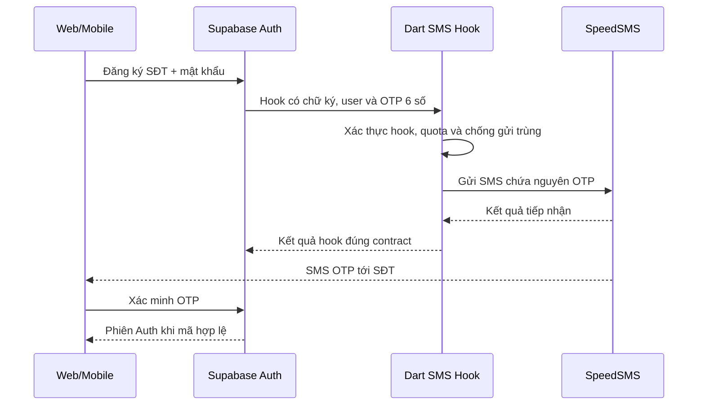

# SpeedSMS cho PicKet: cá nhân, chi phí và Supabase OTP

Tra cứu ngày **03/11/2026, Asia/Saigon**. Nhu cầu: developer cá nhân chưa có đăng ký kinh doanh, xác minh SĐT Việt Nam bằng OTP 6 số; Supabase quản lý SĐT/mật khẩu/phiên, Dart API là backend nghiệp vụ. Phạm vi nguồn là `speedsms.vn` và portal/API được website này liên kết; chưa xác minh quan hệ với dịch vụ tên gần giống trên tên miền khác.

## 1. Kết luận

**SpeedSMS đáng thử PoC cho PicKet, ưu tiên SMS dùng tên gửi chung Verify/Notify. Chưa đủ bằng chứng để chốt provider production hoặc nạp tiền lớn.**

Trang dịch vụ nêu cá nhân/tổ chức là đối tượng sử dụng, có OTP; FAQ nói tên gửi chung không cần đăng ký brandname riêng và không có phí đăng ký/duy trì brandname. Đây là thông tin do nhà cung cấp công bố, chưa phải xác nhận phê duyệt riêng cho PicKet. [Đối tượng sử dụng](https://speedsms.vn/dich-vu-tin-nhan-hien-thi-dau-so/), [FAQ OTP](https://speedsms.vn/sms-otp-service/).

Đề xuất tích hợp **gửi nội dung OTP do Supabase sinh**, không tạo một mã khác bằng 2FA API của SpeedSMS. Chưa thay cấu hình Auth, tạo tài khoản, liên hệ support, nạp tiền hay gửi tin thử trong lượt nghiên cứu này.

## 2. Mức độ kiểm chứng

| Nội dung | Kết quả |
|---|---|
| Dịch vụ có nói hỗ trợ cá nhân và OTP | Có trên trang nhà cung cấp; chưa có xác nhận hồ sơ riêng cho PicKet |
| Sender chung | FAQ công bố Verify/Notify; sender cụ thể và quyền dùng theo account cần xác nhận |
| Giá hiện hành áp dụng cho account | Chưa có; giá website là mốc dự toán, không ghi ngày hiệu lực |
| Nạp tối thiểu, hết hạn số dư, phí tin lỗi, hoàn tiền | Chưa tìm được điều khoản công khai đủ rõ để kết luận |
| Thời gian OTP tới máy | Website quảng bá dưới 10 giây; chưa đo, không coi là SLA đã xác minh |
| API key/account authenticated | Chưa có tài khoản/credentials để kiểm chứng |
| Delivery Viettel/VinaPhone/MobiFone và OTP 6 số | Chưa thử thực tế |
| Cấu hình sẵn trong dropdown Supabase | Không có; cần HTTP Send SMS Hook và adapter riêng |

Đọc HTTPS công khai tại thời điểm khảo sát: trang OTP trả **200**, portal `https://connect.speedsms.vn/` trả **200**, `https://api.speedsms.vn/index.php/user/info` không kèm credentials trả **401 JSON**. Các kết quả chỉ chứng minh địa chỉ phản hồi, không chứng minh gửi OTP thành công. Portal là ứng dụng JavaScript; chưa đăng nhập nên chưa xác nhận các màn hình bên trong.

## 3. Chọn đúng sản phẩm

| Sản phẩm | Đánh giá cho PicKet |
|---|---|
| SMS API, tên gửi chung (`sms_type=4` theo tài liệu) | Ứng viên ưu tiên: chuyển nguyên mã Supabase cấp vào mẫu được duyệt |
| SMS brandname riêng (`sms_type=3`) | Chỉ chọn khi được provider duyệt hồ sơ/sender; chưa coi là khả dụng cho PicKet cá nhân |
| Đầu số random (`sms_type=2`) | Có bảng giá rẻ hơn, nhưng cần xác nhận còn khai thác và chất lượng từng mạng; chưa chọn làm tuyến OTP mặc định |
| Android/SIM relay (`sms_type=5`) | Tài liệu mô tả dùng điện thoại/SIM để phát tin. Không chọn làm phương án vận hành mặc định vì thêm phụ thuộc thiết bị, mạng, pin và SIM; đây là đánh giá vận hành, không phải kết luận pháp lý |
| Voice OTP | Có API gửi mã số sẵn; cần báo giá/khả dụng riêng. Không dùng lời quảng bá tiết kiệm làm đơn giá đã xác nhận |
| 2FA API `pin/create`, `pin/verify` | Provider tự tạo và kiểm mã. Không phù hợp với đường gửi OTP Supabase đã sinh sẵn nếu không thiết kế lại xác thực |

Nguồn: [SMS API Service](https://speedsms.vn/sms-api-service/), [Voice API](https://speedsms.vn/voice-api/), [2FA API](https://speedsms.vn/2-factor-authentication/). “PIN” trong 2FA API là mã dùng một lần, khác PIN đăng nhập nhanh web của PicKet.

## 4. Giá công khai và ngân sách

Trang giá niêm yết:

| Tuyến | Mức trên website |
|---|---:|
| Tên gửi chung Verify | 750đ/SMS trên các mạng liệt kê |
| Random, Viettel | 300đ/SMS |
| Random, MobiFone/VinaPhone/Vietnamobile/Gmobile | 250đ/SMS |

Trang ghi gồm VAT 10%, nhưng không có ngày hiệu lực và có footer cũ. Cần provider xác nhận lại thuế, giá và tuyến áp dụng tại thời điểm mua. [Bảng giá gốc](https://speedsms.vn/bang-gia-dich-vu-tin-nhan-hien-thi-dau-so/).

Phép tính dưới đây chỉ nhân theo 750đ/một lần gửi, giả định mỗi tin là một segment. Chưa cộng phí có thể phát sinh và chưa phải báo giá:

| Nhu cầu | Không gửi lại | Bình quân 1,2 lần gửi/lượt yêu cầu |
|---|---:|---:|
| 100 lượt yêu cầu OTP | 75.000đ | 90.000đ |
| 500 lượt | 375.000đ | 450.000đ |
| 1.000 lượt | 750.000đ | 900.000đ |
| 10.000 lượt | 7.500.000đ | 9.000.000đ |

Số user không phải số tin: còn recovery, resend, đổi SĐT, step-up, yêu cầu bỏ dở và spam. Gói 100/500/1.000 ở đây là kịch bản tính toán, không phải gói bán chính thức của SpeedSMS. Bắt đầu bằng mức nạp nhỏ nhất provider cho phép sau khi có xác nhận dùng thử; chưa biết mức nạp tối thiểu.

## 5. Đăng ký và lấy token

1. Đi từ website [SpeedSMS OTP](https://speedsms.vn/sms-otp-service/) tới [portal chính thức được liên kết](https://connect.speedsms.vn/).
2. Đăng ký bằng thông tin thật và hoàn tất xác minh mà portal yêu cầu. Không suy từ việc tạo được account thành đã có quyền gửi live.
3. Theo tài liệu 2FA, token nằm ở **Settings → Profile**; tài liệu SMS gọi menu là **Tài khoản**. Tìm phần API access token theo giao diện hiện tại hoặc nhờ support chỉ đúng vị trí. [Nguồn vị trí token](https://speedsms.vn/2-factor-authentication/).
4. Hỏi support xác nhận cá nhân, sender chung, mẫu có mã 6 số, cước, tuyến từng mạng và quyền dùng API gửi nội dung sẵn. Chỉ sau đó mới thử live/nạp khoản nhỏ.
5. Đặt token phía backend; không đưa vào mobile/web, chat, URL hoặc Git. Token này không phải key Twilio và không dán vào form Twilio của Supabase.

## 6. Contract kỹ thuật cần PoC

Theo [SMS API](https://speedsms.vn/sms-api/): base HTTPS `https://api.speedsms.vn/index.php/`; xác thực Basic Auth với token làm username; gửi bằng `POST /sms/send`, gồm người nhận/nội dung/loại tin/sender. Có `tranId`, `totalSMS`, `totalPrice`, `invalidPhone` để theo dõi. Tra cứu bằng `/sms/status/{tranId}` và có delivery webhook. Endpoint tra cứu dùng status thành công **1**, webhook thành công **0**: cần adapter riêng, không dùng chung enum.

Đây là contract theo tài liệu, chưa phải đã kiểm thử bằng account. Khi implement:

- Dùng HTTPS, POST JSON và Authorization header; không sao chép ví dụ HTTP hoặc token/OTP trong query string từ tài liệu.
- User trong Supabase dùng E.164. Adapter chỉ đổi sang dạng số provider xác nhận; kiểm tra các đầu số 10 chữ số hiện hành, giữ OTP là chuỗi 6 số để không mất số 0 đầu.
- Xác nhận `sms_type=4`, tên sender và nội dung cụ thể trước khi hardcode adapter. Success ở API nhận yêu cầu chưa chứng minh user đã nhận; kiểm tra invalidPhone và delivery riêng.
- Hỏi provider về idempotency, chữ ký webhook, token rotation/IP restriction, timeout và retry. Tài liệu công khai đã đọc chưa đủ để khẳng định các tính năng này được hỗ trợ.
- Nếu timeout sau khi gửi, tránh retry mù gây nhiều SMS/phí. Lưu metadata/correlation an toàn; hạn chế dữ liệu SĐT và không ghi OTP, token, Authorization header hoặc raw hook body vào log.

## 7. Nối với Supabase

[Send SMS Hook](https://supabase.com/docs/guides/auth/auth-hooks/send-sms-hook) thay đường gửi SMS mặc định; hook nhận dữ liệu OTP từ Auth. Cần endpoint Dart public HTTPS có xác thực hook, rồi cấu hình tại Authentication → Hooks theo dashboard thực tế. Không giả định đổi dropdown hoặc điền token vào Twilio là đủ. Supabase vẫn giữ nguồn phát hành/xác minh mã và session; endpoint hook không là API SMS công cộng.

Khi triển khai, giữ TTL/rate limit của Auth, xác minh chữ ký/timestamp và chống replay. Chỉ trả thành công theo kết quả gửi được tiếp nhận đúng contract; nếu có hàng đợi phải chứng minh thời gian xử lý không vượt TTL. Hạn chế retry, phân biệt lỗi cấu hình/hết tiền/tạm thời. Không gọi `pin/create` để thay mã khác vào cùng challenge.

Phone-only vẫn cần sửa form/SDK calls và email gate trong API PicKet. Khả năng gửi SMS không tự hoàn tất đăng nhập SĐT + mật khẩu, quick PIN hoặc phân quyền mới.

## 8. Dấu hiệu tài liệu cũ và độ tin cậy cần làm rõ

- Nội dung nhiều trang và portal có footer 2018; ví dụ còn đầu số `01x`. Không lấy ngày crawler đọc lại làm ngày chính sách được cập nhật.
- Trang giá ghi Verify; SMS API ghi Notify; hướng dẫn SDK nêu cả hai. Chưa kết luận endpoint hoặc nhãn sender nào account sẽ được cấp.
- Trang OTP giới thiệu voice ở trên nhưng một câu FAQ lại nói chỉ SMS. Cần xác nhận sản phẩm đang hoạt động, không coi mọi lời giới thiệu là khả dụng đồng thời.
- Chính sách quyền riêng tư nêu thu thập thông tin đăng ký, quyền yêu cầu xử lý dữ liệu; chưa có đủ thông tin xác nhận retention riêng cho OTP/SĐT người nhận, nhà xử lý phụ, hoặc quy trình xóa lịch sử gửi. [Chính sách bảo mật](https://speedsms.vn/chinh-sach-bao-mat/).
- Không tìm được SLA có chế tài, uptime được kiểm chứng độc lập, bảng cước riêng cho account hoặc chính sách hoàn tiền/nạp tối thiểu đủ rõ. Đây là khoảng trống thông tin, không phải kết luận dịch vụ ngừng hoạt động.

## 9. Nội dung hỏi support và nghiệm thu

Có thể gửi qua kênh liên hệ trên website, chưa gửi thay user:

> Tôi là developer cá nhân chưa có đăng ký kinh doanh, phát triển PicKet, ứng dụng ghi chép thu chi. Tôi muốn dùng SMS API để chuyển OTP 6 số do Supabase sinh, khoảng 100–1.000 SMS/tháng. Xin xác nhận: (1) cá nhân có được dùng production không, hồ sơ gì; (2) có sender chung Verify/Notify không cần brandname riêng không; (3) giá hiện hành theo mạng, VAT và phí cố định; (4) nạp tối thiểu, hạn số dư và hoàn tiền/tin lỗi; (5) sender/sms_type/mẫu và định dạng SĐT chính xác; (6) có thể test Viettel/VinaPhone/MobiFone trước không; (7) rate limit, retry/idempotency và xác thực delivery webhook; (8) thời hạn lưu nội dung OTP/SĐT, xoay token và xóa dữ liệu?

Chỉ chọn production sau khi: support chấp nhận trường hợp PicKet; account có cước xác nhận; thử OTP đủ 6 số trên các mạng mục tiêu, kiểm tra thời gian nhận và số tiền trừ; xử lý sai/hết hạn/resend/replay/hết tiền/timeout/gửi trùng; không lộ secret và hook không thể bị gọi để spam. Ca thử đầu dùng số của chủ dự án được phép, chi phí nhỏ đã xác định. Nghiên cứu này chưa thay thế các ca nghiệm thu đó.
